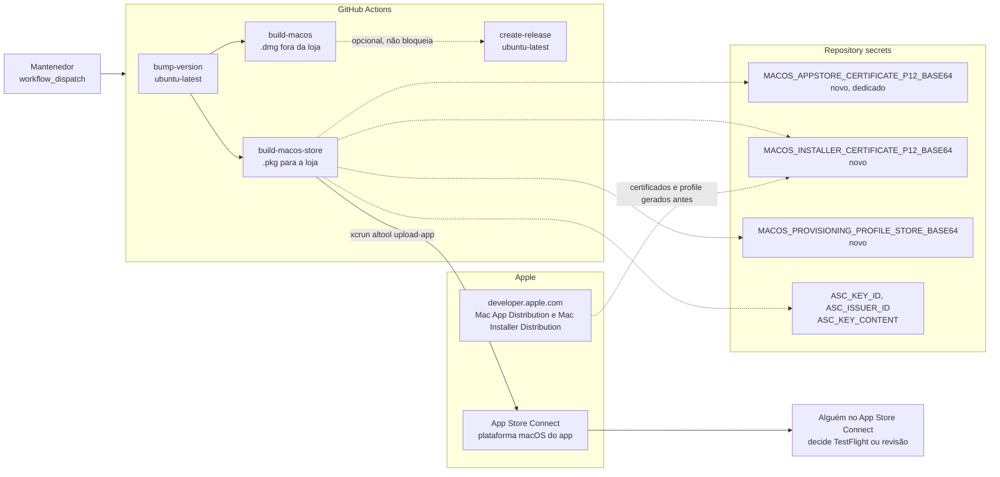
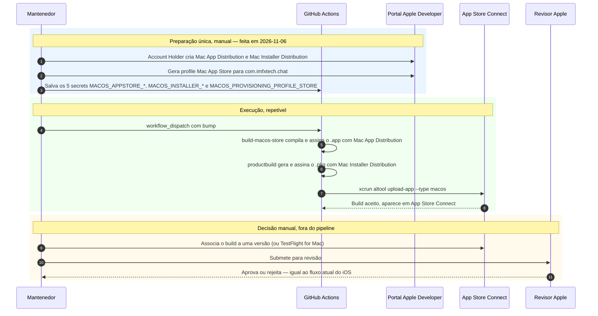

<!--
SPDX-FileCopyrightText: 2026 IMFX TECH LTDA

SPDX-License-Identifier: AGPL-3.0-or-later
-->

# Release do macOS na Mac App Store — desenho da pipeline

Este documento é a spec de um job **novo**, `build-macos-store`, pensado para
`.github/workflows/release-and-build.yml`. Ele é **independente** do que já
existe em `docs/MACOS_RELEASE.md`:

| | `build-macos` (hoje) | `build-macos-store` (este doc) |
|---|---|---|
| Saída | `.dmg` notarizado | `.pkg` assinado pra loja |
| Caminho | Developer ID + notarização, fora da loja | Apple Distribution + Mac Installer Distribution, dentro da Mac App Store |
| Entrega | Anexado à GitHub Release, usuário baixa e instala | `xcrun altool --upload-app` → App Store Connect |
| Sandbox | opcional | **obrigatório** (já está ligado nas entitlements atuais) |

As duas pipelines builadam o mesmo código e podem conviver no mesmo
`workflow_dispatch`: uma gera o instalador direto, a outra alimenta a loja.

## Status (atualizado 2026-11-06)

**Implementado, certificados, secrets e plataforma no lugar — pronto pra
testar o primeiro upload de ponta a ponta no próximo `workflow_dispatch`.**

- ✅ Job `build-macos-store` em `.github/workflows/release-and-build.yml`.
- ✅ App ID `com.imfxtech.chat` **já suportava macOS** — confirmado ao vivo em
  Identifiers (`Platform: iOS, iPadOS, macOS, tvOS, watchOS, visionOS`), nada
  precisou mudar lá.
- ✅ Certificado **Mac App Distribution** gerado (expira 2027/11/06, CN `3rd
  Party Mac Developer Application: Don Silva Martins (Q9FX293J5N)`).
- ✅ Certificado **Mac Installer Distribution** gerado (expira 2027/11/06, CN
  `3rd Party Mac Developer Installer: Don Silva Martins (Q9FX293J5N)`).
- ✅ Provisioning profile **Mac App Store** "IMFxTech Chat macOS App Store"
  gerado pra `com.imfxtech.chat`.
- ✅ Os 5 secrets já existem no repositório (`gh secret set`, autorizado pelo
  Marcelo em 2026-11-06). Backup local em
  [imfxtech-chat-secrets-backup/macos-appstore/](file:///home/marcelo/HD3/botDon/imfxtech-chat-secrets-backup/macos-appstore/README.md).
- ✅ **App Store Connect**: plataforma macOS adicionada à ficha do app
  (Apple ID `6810974674`, autorizado pelo Marcelo em 2026-11-06) — criou "App
  para macOS Versão 1.0" com status "Preparar para envio". **Não** cliquei em
  "Adicionar para revisão": isso manda o app pra análise da Apple, passo além
  do que foi pedido (confirmar a plataforma).
- ⏳ **Export Compliance** da plataforma macOS e demais metadados da versão
  1.0 (screenshots, descrição) ainda não foram preenchidos — normalmente só
  são exigidos no momento de enviar pra revisão, não antes.

O job já roda o caminho assinado completo na próxima `workflow_dispatch`.

## Decisões deste desenho

- **Job paralelo, não bloqueante.** `build-macos-store` roda junto com
  `build-android` / `build-ios` / `build-macos`, mas **não** entra no `needs`
  do `create-release` e **não** vira asset da GitHub Release — só sobe pro App
  Store Connect. Um `.pkg` assinado pra loja não passa pelo Gatekeeper fora
  dela (sem notarização própria; a confiança vem do recibo da loja), então
  anexá-lo à Release não ajudaria quem baixa direto do GitHub.
- **Não reaproveita o certificado do iOS.** A suposição original deste
  desenho era usar `IOS_CERTIFICATE_P12_BASE64` (achando que era o tipo
  unificado "Apple Distribution", válido pra iOS *e* macOS). Checando ao vivo
  no portal, o certificado existente é do tipo legado **iOS Distribution**
  (plataforma só iOS/iPadOS/watchOS/visionOS) — não assina macOS. Por isso
  foi gerado um certificado **dedicado**, Mac App Distribution, só pra esse
  job (não mexe no certificado do iOS nem no job `build-ios`).
- **Entitlements sem mudança.** `macos/Runner/Release.entitlements` já tem
  `com.apple.security.app-sandbox = true` — exigido pela Mac App Store e
  nenhuma das outras entitlements (câmera, áudio, rede, localização, arquivos
  escolhidos pelo usuário) impede sandboxing. Mesmo arquivo serve pro `.dmg` e
  pro `.pkg`.
- **Dois itens genuinamente novos:** certificado **Mac Installer
  Distribution** (assina o `.pkg`; não existe equivalente no fluxo do iOS) e
  um provisioning profile **Mac App Store** pro bundle `com.imfxtech.chat`
  (perfil é por plataforma — o profile do iOS não serve aqui).

## Pontos ainda em aberto

1. ~~Plataforma macOS no App ID~~ — **resolvido**, já estava habilitada.
2. **App Store Connect: adicionar a plataforma macOS ao app existente** (o
   mesmo "IMFxTech Chat", Apple ID `6810974674`). O diálogo "Adicionar
   plataforma" (em Distribuição → "+" ao lado de "App para iOS") já confirma
   que dá pra adicionar macOS à mesma ficha — evita duplicar
   categoria/descrição/política de privacidade. Falta só confirmar e enviar.
3. **TestFlight for Mac vs. direto pra revisão.** Depois do primeiro
   `altool --upload-app` bem-sucedido, alguém com acesso ao App Store Connect
   decide manualmente se o build vai pra TestFlight (beta) ou é anexado a uma
   versão e enviado pra revisão — igual ao iOS, o job só faz o upload, não
   submete.
4. **Export Compliance.** Mesma declaração de criptografia E2E já preenchida
   pro iOS deve ser repetida (ou confirmada) pra plataforma macOS do app —
   normalmente aparece ao adicionar a plataforma ou no primeiro envio.

## Secrets

| Secret | Conteúdo | Status |
|---|---|---|
| `MACOS_APPSTORE_CERTIFICATE_P12_BASE64` | `.p12` do certificado **Mac App Distribution** (assina o `.app`) | gerado, falta subir no GitHub |
| `MACOS_APPSTORE_CERTIFICATE_PASSWORD` | senha do `.p12` acima | gerado, falta subir no GitHub |
| `MACOS_INSTALLER_CERTIFICATE_P12_BASE64` | `.p12` do certificado **Mac Installer Distribution** (assina o `.pkg`) | gerado, falta subir no GitHub |
| `MACOS_INSTALLER_CERTIFICATE_PASSWORD` | senha do `.p12` acima | gerado, falta subir no GitHub |
| `MACOS_PROVISIONING_PROFILE_STORE_BASE64` | profile **Mac App Store** de `com.imfxtech.chat` | gerado, falta subir no GitHub |
| `ASC_KEY_ID`, `ASC_ISSUER_ID`, `ASC_KEY_CONTENT` | chave de API do App Store Connect, já usada no upload do iOS e na notarização do `.dmg` | já existe, reaproveitado |

Os `.p12`/`.provisionprofile` e os comandos `gh secret set` exatos estão em
[imfxtech-chat-secrets-backup/macos-appstore/README.md](file:///home/marcelo/HD3/botDon/imfxtech-chat-secrets-backup/macos-appstore/README.md).

## Passos no Apple Developer / App Store Connect

1. ~~Mac App Distribution~~ e ~~Mac Installer Distribution~~ — **feito**,
   certificados gerados via CSR própria (não reaproveita a do iOS).
2. ~~Confirmar/habilitar macOS no App ID~~ — **feito**, já estava habilitado.
3. ~~Provisioning profile Mac App Store~~ — **feito**, "IMFxTech Chat macOS
   App Store" gerado pra `com.imfxtech.chat` com o certificado Mac App
   Distribution.
4. Salvar os 5 secrets da tabela acima no GitHub (pendente — ver README da
   pasta de backup).
5. Em App Store Connect, adicionar a plataforma **macOS** à ficha existente
   do app (ver "Pontos ainda em aberto" item 2) e preencher o Export
   Compliance pra essa plataforma.

## Arquitetura

## Fluxo do job `build-macos-store`

## Sequência do upload

## Onde cada coisa está

| Peça | Arquivo |
|---|---|
| Pipeline | `.github/workflows/release-and-build.yml` (job `build-macos-store`) |
| Entitlements (reaproveitadas) | `macos/Runner/Release.entitlements` |
| Bundle ID, nome | `macos/Runner/Configs/AppInfo.xcconfig` (`com.imfxtech.chat`, mesmo do iOS) |
| Pipeline irmã (fora da loja) | `docs/MACOS_RELEASE.md` |
| Pipeline equivalente do iOS (TestFlight) | `docs/IOS_RELEASE_SIGNING.md` |
