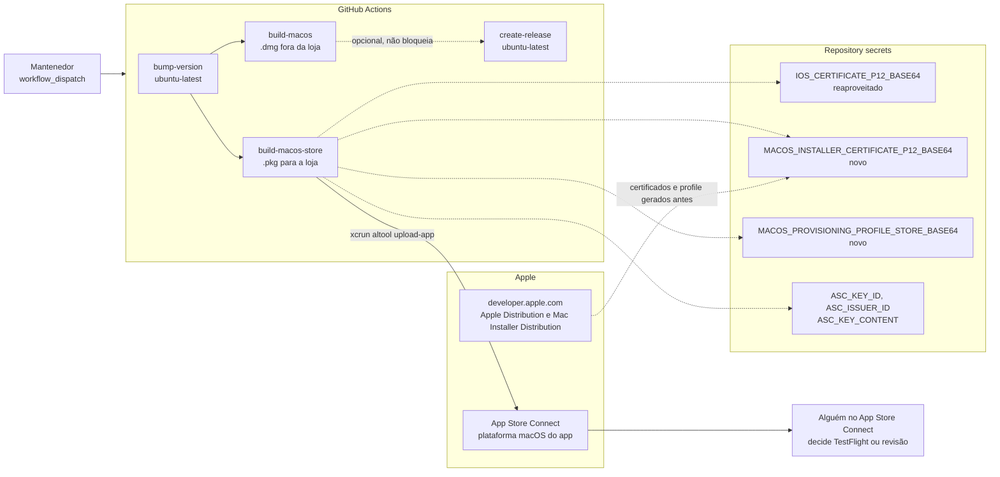
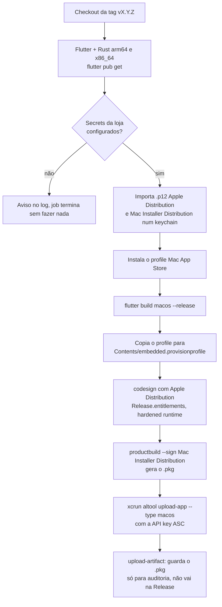
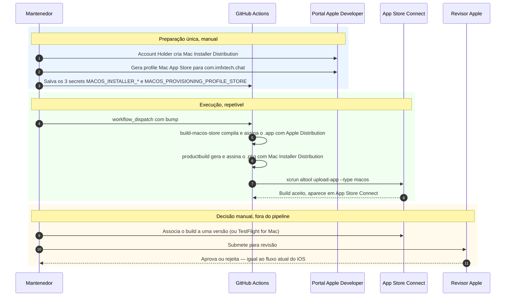

<!--
SPDX-FileCopyrightText: 2026 IMFX TECH LTDA

SPDX-License-Identifier: AGPL-3.0-or-later
-->

# Release do macOS na Mac App Store — desenho da pipeline

Este documento é a spec de um job **novo**, `build-macos-store`, pensado para
`.github/workflows/release-and-build.yml`. Ele é **independente** do que já
existe em `docs/MACOS_RELEASE.md`:

| | `build-macos` (hoje) | `build-macos-store` (este doc) |
|---|---|---|
| Saída | `.dmg` notarizado | `.pkg` assinado pra loja |
| Caminho | Developer ID + notarização, fora da loja | Apple Distribution + Mac Installer Distribution, dentro da Mac App Store |
| Entrega | Anexado à GitHub Release, usuário baixa e instala | `xcrun altool --upload-app` → App Store Connect |
| Sandbox | opcional | **obrigatório** (já está ligado nas entitlements atuais) |

As duas pipelines builadam o mesmo código e podem conviver no mesmo
`workflow_dispatch`: uma gera o instalador direto, a outra alimenta a loja.

## Status

**Desenhado e implementado no workflow, gated por secrets ausentes — ainda não
testado de ponta a ponta.** O job já está em
`.github/workflows/release-and-build.yml` (ver seção "Onde cada coisa está"),
mas sem os secrets abaixo ele só roda o checkout e sai sem fazer nada —
mesmo padrão que `build-ios` e `build-macos` usaram enquanto os certificados
deles não existiam.

## Decisões deste desenho

- **Job paralelo, não bloqueante.** `build-macos-store` roda junto com
  `build-android` / `build-ios` / `build-macos`, mas **não** entra no `needs`
  do `create-release` e **não** vira asset da GitHub Release — só sobe pro App
  Store Connect. Um `.pkg` assinado pra loja não passa pelo Gatekeeper fora
  dela (sem notarização própria; a confiança vem do recibo da loja), então
  anexá-lo à Release não ajudaria quem baixa direto do GitHub.
- **Reaproveita o certificado Apple Distribution do iOS**
  (`IOS_CERTIFICATE_P12_BASE64` / `IOS_CERTIFICATE_PASSWORD`). Desde que a
  Apple unificou o tipo de certificado em 2019, **Apple Distribution** assina
  pra iOS App Store *e* Mac App Store — e foi esse o tipo gerado no passo 2 de
  `docs/IOS_RELEASE_SIGNING.md` (não o antigo "iOS Distribution"). Não cria
  secret novo pra isso.
- **Entitlements sem mudança.** `macos/Runner/Release.entitlements` já tem
  `com.apple.security.app-sandbox = true` — exigido pela Mac App Store e
  nenhuma das outras entitlements (câmera, áudio, rede, localização, arquivos
  escolhidos pelo usuário) impede sandboxing. Mesmo arquivo serve pro `.dmg` e
  pro `.pkg`.
- **Dois itens genuinamente novos:** certificado **Mac Installer
  Distribution** (assina o `.pkg`; não existe equivalente no fluxo do iOS) e
  um provisioning profile **Mac App Store** pro bundle `com.imfxtech.chat`
  (perfil é por plataforma — o profile do iOS não serve aqui).

## Pontos a confirmar antes do primeiro run real

1. **Plataforma macOS no App ID.** `com.imfxtech.chat` já existe no portal
   (criado pro iOS). Falta confirmar, em Identifiers → `com.imfxtech.chat`,
   que a plataforma **macOS** está habilitada — se o App ID foi criado só
   como "iOS, tvOS, watchOS", é preciso habilitar macOS antes de gerar o
   profile do passo 3 abaixo.
2. **App Store Connect: adicionar a plataforma macOS ao app existente** (o
   mesmo "IMFxTech Chat", Apple ID `6810974674`) ou decidir se vira um
   registro separado. O caminho recomendado é a mesma ficha, plataforma
   adicional — evita duplicar categoria/descrição/política de privacidade.
3. **TestFlight for Mac vs. direto pra revisão.** Depois do primeiro
   `altool --upload-app` bem-sucedido, alguém com acesso ao App Store Connect
   decide manualmente se o build vai pra TestFlight (beta) ou é anexado a uma
   versão e enviado pra revisão — igual ao iOS, o job só faz o upload, não
   submete.
4. **Export Compliance.** Mesma declaração de criptografia E2E já preenchida
   pro iOS deve ser repetida (ou confirmada) pra plataforma macOS do app.

## Secrets

| Secret | Conteúdo | Novo? |
|---|---|---|
| `MACOS_INSTALLER_CERTIFICATE_P12_BASE64` | `.p12` do certificado **Mac Installer Distribution** com a chave privada, em base64 | **sim** |
| `MACOS_INSTALLER_CERTIFICATE_PASSWORD` | senha do `.p12` acima | **sim** |
| `MACOS_PROVISIONING_PROFILE_STORE_BASE64` | profile **Mac App Store** de `com.imfxtech.chat` (plataforma macOS), em base64 | **sim** |
| `IOS_CERTIFICATE_P12_BASE64` / `IOS_CERTIFICATE_PASSWORD` | certificado **Apple Distribution**, já usado no `build-ios` | não, reaproveitado |
| `ASC_KEY_ID`, `ASC_ISSUER_ID`, `ASC_KEY_CONTENT` | chave de API do App Store Connect, já usada no upload do iOS e na notarização do `.dmg` | não, reaproveitado |

## Passos no Apple Developer / App Store Connect

1. **Mac Installer Distribution:** Certificates, Identifiers & Profiles →
   Certificates → "+" → **Mac Installer Distribution**. Só o **Account
   Holder** cria. CSR igual ao dos outros certificados
   (`docs/IOS_RELEASE_SIGNING.md`, passo 2) — pode ser outro par de chaves ou
   reaproveitar o mesmo CSR do Apple Distribution, a Apple aceita o mesmo CSR
   pra tipos de certificado diferentes.
2. **Confirmar/habilitar macOS no App ID** `com.imfxtech.chat` (ver "Pontos a
   confirmar" item 1).
3. **Provisioning profile:** Profiles → "+" → **Mac App Store** (não
   "Developer ID") → App ID `com.imfxtech.chat` → certificado Apple
   Distribution do passo anterior (o mesmo usado no iOS). Baixar o
   `.provisionprofile`.
4. Salvar os 3 secrets novos da tabela acima.
5. Em App Store Connect, adicionar a plataforma **macOS** à ficha existente
   do app (ver "Pontos a confirmar" item 2) e preencher o Export Compliance
   pra essa plataforma.

## Arquitetura

## Fluxo do job `build-macos-store`

## Sequência do upload

## Onde cada coisa está

| Peça | Arquivo |
|---|---|
| Pipeline | `.github/workflows/release-and-build.yml` (job `build-macos-store`) |
| Entitlements (reaproveitadas) | `macos/Runner/Release.entitlements` |
| Bundle ID, nome | `macos/Runner/Configs/AppInfo.xcconfig` (`com.imfxtech.chat`, mesmo do iOS) |
| Pipeline irmã (fora da loja) | `docs/MACOS_RELEASE.md` |
| Pipeline equivalente do iOS (TestFlight) | `docs/IOS_RELEASE_SIGNING.md` |
