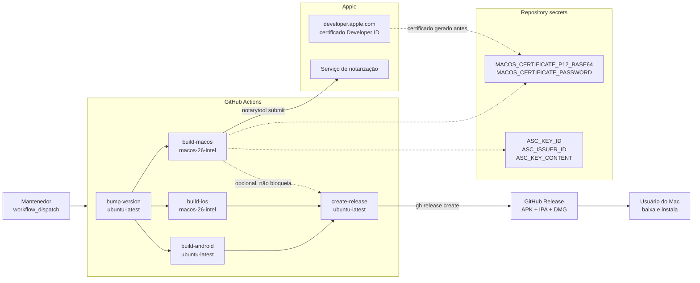
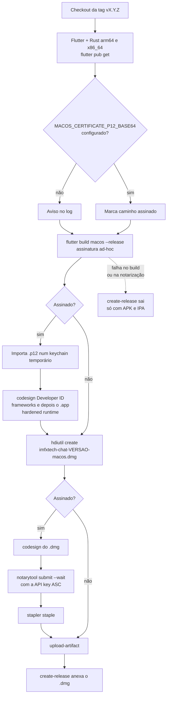
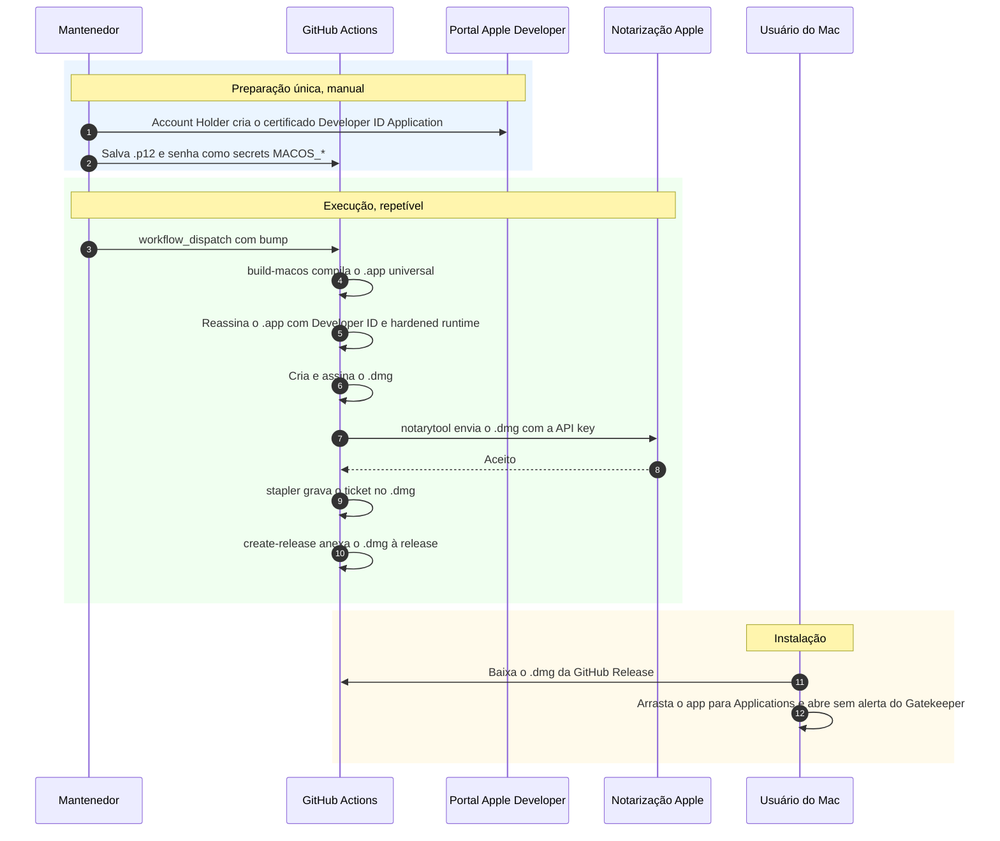

<!--
SPDX-FileCopyrightText: 2026 IMFX TECH LTDA

SPDX-License-Identifier: AGPL-3.0-or-later
-->

# Release do macOS — build, assinatura e distribuição

O app nativo do macOS sai do mesmo workflow `Release and Build`
(`.github/workflows/release-and-build.yml`), no job `build-macos`. O resultado
é um `imfxtech-chat-<versão>-macos.dmg` anexado à GitHub Release, ao lado do
APK e do IPA.

- **Nome do app:** `IMFxTech Chat.app` (`PRODUCT_NAME` em
  `macos/Runner/Configs/AppInfo.xcconfig`).
- **Bundle ID:** `com.imfxtech.chat`, o mesmo do app iOS. Um único App ID
  serve as duas plataformas.
- **Team:** `Q9FX293J5N`, o mesmo do release iOS
  (`macos/Runner.xcodeproj/project.pbxproj`).
- **Distribuição:** `.dmg` fora da Mac App Store, assinado com certificado
  **Developer ID Application** e notarizado pela Apple. Publicar na Mac App
  Store é outro fluxo (certificados Apple Distribution e Mac Installer
  Distribution, perfil de provisionamento e upload de `.pkg`) e não está
  implementado.

## Como gerar

1. Em **Actions → Release and Build → Run workflow**, escolher o tipo de bump.
2. O job `build-macos` roda `flutter build macos --release` (binário universal
   arm64 + x86_64) com assinatura ad-hoc e empacota o `.app` num `.dmg` com
   atalho para `/Applications` (`hdiutil create`).
3. Se o secret `MACOS_CERTIFICATE_P12_BASE64` existir, o job reassina o `.app`
   com o Developer ID (hardened runtime e `Release.entitlements`), assina o
   `.dmg`, envia para notarização (`xcrun notarytool`) e grampeia o ticket
   (`xcrun stapler`).
4. Sem esse secret, o `.dmg` sai sem Developer ID e sem notarização. O log do
   job mostra um aviso e a nota da release diz que o Gatekeeper vai bloquear a
   primeira abertura (botão direito → Abrir contorna).
5. O macOS **não bloqueia** a release: se o build ou a notarização falharem,
   o `create-release` roda mesmo assim (Android e iOS já foram para as lojas)
   e publica a GitHub Release só com APK e IPA, sem o `.dmg` nem a linha de
   macOS nas notas.

Build local num Mac: `flutter build macos --release`. Para rodar em modo
debug sem conta Apple no Xcode, trocar o signing do target Runner para
"Sign to Run Locally".

## Secrets

| Secret | Conteúdo | Novo? |
|---|---|---|
| `MACOS_CERTIFICATE_P12_BASE64` | `.p12` do certificado **Developer ID Application** com a chave privada, em base64 (`base64 -w0 devid.p12`) | sim |
| `MACOS_CERTIFICATE_PASSWORD` | senha do `.p12` | sim |
| `ASC_KEY_ID`, `ASC_ISSUER_ID`, `ASC_KEY_CONTENT` | chave de API do App Store Connect, já usada no upload do iOS. O `notarytool` aceita a mesma chave | não, reaproveitados |

O certificado Apple Distribution do iOS **não** serve aqui: notarização de
`.dmg` exige Developer ID.

## Passos no Apple Developer

1. **Developer ID Application:** em Certificates, Identifiers & Profiles →
   Certificates → "+" → **Developer ID Application**. Só o **Account Holder**
   do time cria certificados Developer ID. O CSR pode ser gerado com OpenSSL,
   igual ao do iOS (`docs/IOS_RELEASE_SIGNING.md`, passo 2), e o `.cer` vira
   `.p12` do mesmo jeito.
2. **App ID:** o `com.imfxtech.chat` já existe para o iOS. Nada a criar para
   o `.dmg`: Developer ID com as entitlements atuais (sandbox, rede, câmera,
   microfone, localização, arquivos escolhidos pelo usuário, fotos) não
   precisa de provisioning profile.
3. **Chave de API (ASC):** a chave já cadastrada nos secrets precisa ter papel
   **Developer** ou superior para notarizar. Se for App Manager ou Admin, já
   serve.
4. Salvar `MACOS_CERTIFICATE_P12_BASE64` e `MACOS_CERTIFICATE_PASSWORD` nos
   secrets do repositório.

Se um dia o app macOS precisar de capability que exige perfil (App Group,
Push Notifications, iCloud, `keychain-access-groups` preenchido), aí será
preciso habilitar macOS no App ID, gerar um perfil **Developer ID** para
`com.imfxtech.chat` e embuti-lo no `.app` antes de assinar. Hoje
`keychain-access-groups` está vazio e o banco não usa App Group no macOS
(só no iOS).

## Arquitetura

## Fluxo do job `build-macos`

## Sequência da notarização

## Onde cada coisa está

| Peça | Arquivo |
|---|---|
| Pipeline | `.github/workflows/release-and-build.yml` (job `build-macos`) |
| Nome, bundle ID, copyright | `macos/Runner/Configs/AppInfo.xcconfig` |
| Team e signing do Xcode | `macos/Runner.xcodeproj/project.pbxproj` |
| Entitlements | `macos/Runner/DebugProfile.entitlements`, `macos/Runner/Release.entitlements` |
| Ícones | `macos/Runner/Assets.xcassets/AppIcon.appiconset/` (gerados da arte do iOS, na grade de ícone do macOS) |
| Teste de regressão do rebrand | `test/macos_target_test.dart` |
